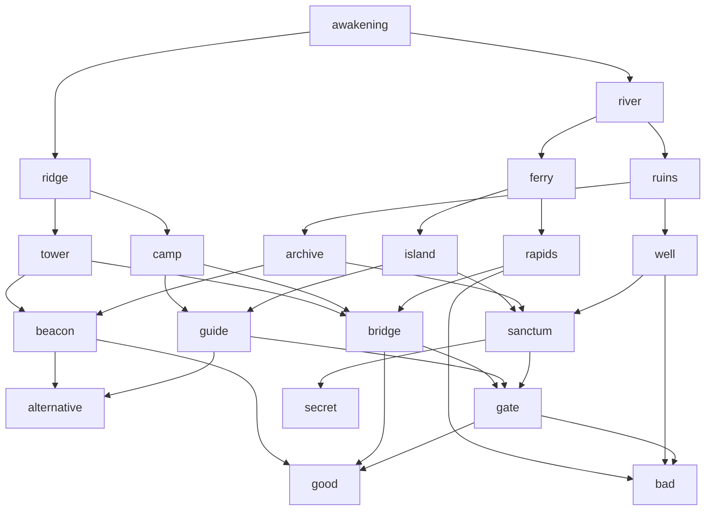

# Hoàn thiện Lab 7 — Destini

Ngày kiểm chứng: 16/11/2026.

## Phân tích mã nguồn

Mã nguồn khi bắt đầu lượt hoàn thiện này đã có Destini với 20 node, dữ liệu truyện riêng, reducer, hook chuyển cảnh và bộ component story. Target Rush vẫn tồn tại ở route riêng. Đã đọc toàn bộ mã ứng dụng, hook, dữ liệu, tiện ích, cấu hình, script và kiểm thử trước khi chỉnh sửa.

Tiếp tục trên kiến trúc React + TypeScript / Expo SDK 58.0.25 / React Native 0.88.1 hiện có. Giữ nguyên nội dung và các đích lựa chọn của truyện, Expo Router, Target Rush, dependency và cấu hình native. Không tạo lại dự án.

Phần hoàn thiện tập trung vào ảnh minh họa trong khung truyện, tổng kết quyết định quan trọng, lịch sử có thể mở lại, hiệu ứng riêng cho bốn kết thúc, bố cục mobile và trợ năng web.

## Cấu trúc dữ liệu

`src/data/stories.ts` chứa `Record<StoryId, StoryNode>`.

```typescript
interface StoryChoice {
  text: string;
  hint: string;
  nextStoryId: StoryId;
}

interface StoryNode {
  id: StoryId;
  title: string;
  description: string;
  chapter: string;
  image: StoryScene;
  choices: StoryChoice[];
  keyDecision?: boolean;
  isEnding?: boolean;
  endingType?: "good" | "bad" | "secret" | "alternative";
}
```

- `STORY_IDS` khai báo 20 ID hợp lệ; `StoryId` là union suy ra từ danh sách này. TypeScript kiểm tra ID đích và yêu cầu object dữ liệu có đủ các node.
- 16 node phân nhánh, mỗi node có hai lựa chọn dẫn tới diễn biến khác nhau; bốn node kết thúc có danh sách lựa chọn rỗng.
- `keyDecision` đánh dấu các bước ngoặt để lấy ra trong phần tổng kết. Lịch sử đầy đủ vẫn ghi mọi lựa chọn.
- `image` là khóa trong `src/data/scene-images.ts`, ánh xạ sang 10 SVG được đóng gói cục bộ trong `assets/story/`. Không tải ảnh từ dịch vụ ngoài.

## Cách phân nhánh

`src/utils/story.ts` chứa logic thuần, không phụ thuộc React hoặc giao diện. `src/hooks/use-story-game.ts` nối reducer với UI và quản lý timer chuyển cảnh.

1. Bắt đầu lưu `startedAt`, giữ node đầu `awakening`.
2. Chọn một phương án khóa thao tác ngay, hiển thị trạng thái chuyển cảnh trong 350 ms (0 ms khi giảm chuyển động).
3. Reducer xác minh lượt chơi `run`, node xuất phát, chỉ số nguyên hợp lệ, trạng thái bắt đầu/kết thúc và node đích.
4. Thêm `{ storyId, nextStoryId, text }` vào lịch sử, cập nhật `currentId`.
5. Khi tới node kết thúc, lưu `finishedAt`; bỏ qua lựa chọn tiếp theo.
6. Restart hủy timer, tăng `run` để vô hiệu hóa callback cũ, xóa lịch sử và thời gian; đưa về màn bắt đầu. Rời route cũng hủy chuyển cảnh đang chờ.



Không có chu trình, ID bị thiếu, node không tới được hoặc ngõ cụt. Tới kết thúc luôn có nút Chơi lại.

Tiến trình lấy số lựa chọn đã thực hiện chia cho tổng số lựa chọn đã thực hiện và độ dài đường còn lại dài nhất từ node hiện tại. Giá trị tăng trên từng tuyến, đạt 100% ở mọi kết thúc. Số cảnh bằng số lựa chọn + 1 sau khi bắt đầu.

`storySummary(state)` chỉ trả kết quả khi trò chơi đã kết thúc: loại/kết quả kết thúc, số cảnh, số lựa chọn, thời gian và các quyết định quan trọng theo đúng thứ tự, kèm nơi đã đến.

## Các kết thúc

| Loại | Node | Số tuyến tới được | Ví dụ tuyến |
| --- | --- | ---: | --- |
| Good | good | 13 | awakening → ridge → tower → beacon → good |
| Bad | bad | 10 | awakening → river → ruins → well → bad |
| Secret | secret | 3 | awakening → river → ruins → archive → sanctum → secret |
| Alternative | alternative | 4 | awakening → ridge → camp → guide → alternative |

Tổng cộng 30 tuyến hoàn chỉnh. Mỗi kết thúc có minh họa, nhãn, biểu tượng và màu riêng. Hiệu ứng: Good có tia sáng; Bad có màn sương trôi; Secret có biểu tượng xoay và hạt sáng; Alternative có ánh lửa bay lên. Hiệu ứng hữu hạn, được dọn khi unmount và dừng chuyển động khi bật Reduce Motion.

## Giao diện và component

- `StoryGame` ghép màn bắt đầu, nội dung, lựa chọn, tiến trình, lịch sử và kết thúc.
- `StoryArtwork` hiển thị ảnh minh họa và chương; giảm chiều cao trên mobile để dành chỗ đọc.
- `StoryDisplay` fade/slide nội dung mới, giảm độ sáng khi chờ chuyển cảnh.
- `StoryChoices` phản hồi hover, focus, nhấn; khóa lựa chọn khi đang chuyển cảnh.
- `StoryProgress` hiển thị phần trăm, số cảnh và số lựa chọn với thuộc tính ARIA phù hợp web/native.
- `StoryHistory` cho phép mở/đóng từng quyết định để đọc lại nội dung và nơi đã đến.
- `EndingScreen` ghép `EndingEffect`, nội dung kết thúc và `StorySummary`.
- `GameControls` giữ chức năng Chơi lại có sẵn.
- `LabScreen` có hai tùy chọn riêng cho Destini: `scrollResetKey` để về đầu khi đổi cảnh và `compactHeader` để thu gọn tiêu đề trên mobile. Các màn khác dùng giá trị mặc định.

Dùng Animated của React Native để cùng chạy trên Android, iOS và web; không thêm Framer Motion hoặc thư viện native mới. Ảnh cục bộ không cần mạng. Giao diện tôn trọng safe area và cài đặt giảm chuyển động.

## File tạo mới trong lượt này

- `src/components/story/StoryArtwork.tsx`
- `src/components/story/EndingEffect.tsx`
- `src/components/story/StorySummary.tsx`

## File chỉnh sửa trong lượt này

- `src/data/stories.ts`: kiểu StoryId và đánh dấu các quyết định quan trọng.
- `src/utils/story.ts`: kiểu ID, kiểm tra chỉ số lựa chọn và hàm tổng kết thuần.
- `src/components/story/StoryGame.tsx`: ghép ảnh, chuyển cảnh, tiến trình mobile và reset vị trí cuộn.
- `src/components/story/StoryDisplay.tsx`: minh họa, fade/slide và typography responsive.
- `src/components/story/StoryChoices.tsx`: trạng thái focus/nhấn và trợ năng.
- `src/components/story/StoryProgress.tsx`: giá trị tiến trình cho trình đọc màn hình.
- `src/components/story/StoryHistory.tsx`: mở lại tình huống và đích đến.
- `src/components/story/EndingScreen.tsx`: hiệu ứng riêng và tổng kết.
- `src/components/lab-ui.tsx`: tùy chọn cuộn/tiêu đề, dùng kiểu ScrollViewInstance của RN 0.88.
- `tests/story.test.mjs`: mở rộng kiểm thử ảnh, tổng kết, dữ liệu ID, phân bố kết thúc, trạng thái sai và reset.
- `README.md`
- `UPGRADE.md`

Ảnh chụp, báo cáo trình duyệt và bundle kiểm chứng nằm trong `.validation/`, được gitignore.

## Kết quả kiểm chứng

- `npm run typecheck`: đạt.
- `npm run lint`: đạt.
- `npm test`: 6/6 đạt, gồm ba kiểm thử Destini và ba kiểm thử Target Rush.
- Duyệt đủ 30 tuyến bằng reducer: tất cả node và bốn kết thúc đều tới được; đích hợp lệ, ảnh tồn tại, không chu trình/ngõ cụt, tiến trình tăng, lịch sử và tổng kết chính xác, Restart sạch dữ liệu.
- Chrome tự động chơi cả 30 tuyến: nội dung chuyển đúng, lịch sử mở/đóng được, tổng kết đúng, tiến trình 100% khi kết thúc và Restart về 0%.
- Kiểm tra bốn kết thúc khi bật animation, loading, nhấn nhanh liên tục và Restart trong lúc chuyển cảnh.
- Kiểm tra responsive ở 320×568, 390×844, 768×1024, 1440×1000 và 844×390; không tràn ngang.
- Kiểm tra về đầu nội dung khi chuyển cảnh trên mobile; tiêu đề tình huống nằm trong vùng nhìn thấy ngay cả ở 320×568.
- Kiểm tra focus và Enter để chọn bằng bàn phím; đổi tab khi đang chuyển cảnh hủy lựa chọn đang chờ đúng cách.
- Kiểm tra liên kết Hướng dẫn → Target Rush, bắt đầu, tạm dừng và tiếp tục.
- Báo cáo Chrome: `.validation/finalize-browser.json` và `.validation/finalize-responsive.json`, không có lỗi JavaScript hoặc cảnh báo console. Máy chủ đã được khởi động lại với cache sạch để kiểm chứng lần cuối.
- `npx expo export --platform all --output-dir .validation/export-finalize`: bundle Android, iOS và static web xuất thành công.

Đối chiếu SHA-256 với nguồn trước chỉnh sửa xác nhận `src/app/target-rush.tsx`, `src/utils/game.ts`, `tests/domain.test.mjs` và toàn bộ ảnh cũ không thay đổi. Mọi thao tác ghi nằm trong thư mục Lab7; không sửa package/dependency, route, cấu hình hay Lab khác.

Lượt chơi lưu trong bộ nhớ, không khôi phục sau khi tải lại. Thời gian tính theo đồng hồ từ lúc bắt đầu đến kết thúc, gồm thời gian rời ứng dụng. Đã kiểm tra bundle native; chưa chạy bản cài trên thiết bị Android/iOS thật.

## Tài liệu đối chiếu SDK

- [Expo SDK 58](https://docs.expo.dev/versions/v58.0.0/)
- [Expo Image SDK 58](https://docs.expo.dev/versions/v58.0.0/sdk/image/)
- [Expo Router SDK 58](https://docs.expo.dev/versions/v58.0.0/sdk/router/)
- [Animation trong Expo](https://docs.expo.dev/develop/user-interface/animation/)
